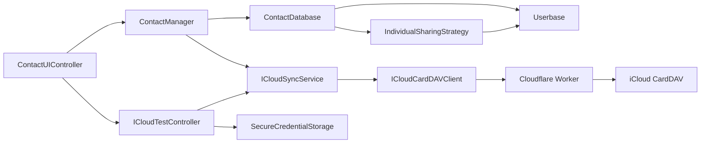

# Contact Management System: Feature, Cleanup, and Review Plan

**Original review:** 2026-09-11 (static review)  
**Revised:** 2026-10-14 — reflects the iCloud consolidation (2026-10-07/08, see [ICLOUD_SYNC_REVIEW.md](ICLOUD_SYNC_REVIEW.md)) and the generic-CardDAV removal + sharing fixes landed on this date.  
**Re-verified:** 2026-10-14 — every claim below was checked against the code at HEAD (including the sharing-retry commits landed later the same day); corrections and new findings are folded in.  
**Guard rail:** `npm test` — 15 suites / 114 tests (iCloud sync, Worker proxy, user-to-user sharing, dedup).

## 0. To-Do at a Glance

**Done — 15:**

- [x] Drop legacy `distribution-sharing` database path (A)
- [x] Read-only sharing only — no configurable permission parameters (A, SH-03)
- [x] Drop username pre-validation (A, SH-06)
- [x] One-time group expansion, no retroactive inference (A, SH-04)
- [x] Remove `CATEGORIES:SHARED:` sharing backup (A)
- [x] Delete dead `tests/integration.test.js` (A, CR-01)
- [x] Unify `updateContactAcrossSharedDatabases` result keys (A, CR-03)
- [x] S-1 dirty flag instead of timestamp comparison (B)
- [x] Remove IC-06 synthetic `shared-contact@userbase.app` email (B)
- [x] SEC-03 remove plaintext read fallback (`localStorage_plain`) (C)
- [x] SEC-04 enable the Worker `RATE_LIMITER` binding (C — `wrangler deploy` still pending)
- [x] Remove `UserbaseConnectionFix.js` (A — see A "dead helpers")
- [x] CR-04 regenerate `production.zip` (after the 2026-10-14 fixes)
- [x] Sharing tests: recipient projection + granular revocation (E)
- [x] Sharing tests: group expansion / list-edit isolation, metadata cleanup + conflict retry, transient-error retry (E)

**Open — 21:**

*Phase A — cleanup*

- [ ] Collapse the two vCard façades into one entry point
- [ ] Align `ContactManager` validation with vCard 3.0
- [ ] Re-justify or remove `AuthPerformanceTracker` (`UserbaseConnectionFix.js` removed 2026-10-14)

*Phase B — iCloud sync rules*

- [ ] S-3 archived = frozen in both directions
- [ ] S-2 drop `sharedContactSyncCache`
- [ ] S-5 finish the tombstone collapse: drop `syncStatus` sub-states, reduce tombstone to `{ uid, deletedAt }` (flow itself is done)
- [ ] S-4 one periodic cycle instead of three timers
- [ ] IS-09 route `testConnect()` through `ICloudSyncService.initialize()`

*Phase C — credentials*

- [ ] SEC-01 implement or remove the session-storage option
- [ ] SEC-02 private-mode salt without `localStorage`
- [ ] SEC-04 deploy the Worker with the rate-limit binding (`wrangler deploy`)

*Phase D — structure (after A–C)*

- [ ] Split `ContactUIController` by workflow
- [ ] Extract import/dedup, sharing, groups from `ContactManager`
- [ ] Extract auth, SDK wrappers, discovery from `ContactDatabase`
- [ ] Use `ContactRenderer.getContactType()` everywhere

*Phase E — verification*

- [ ] `ICloudCardDAVClient` unit tests (XML fixtures)
- [ ] Recipient-side normalization tests (`handleContactsChanged` shared branch)
- [ ] One browser smoke test (app boots, modals open, no console errors)

*Findings & housekeeping (no phase slot)*

- [ ] SH-05 recipient delete vs archive semantics — product rule needed
- [ ] CR-02 route `IndividualSharingStrategy` through the injected `this.database` (no global `userbase`)
- [ ] Update `production_zip.sh` critical-file list (7 files missing)
- [ ] Reduce `.github/copilot-instructions.md` to the iCloud-only model

## 1. Purpose

A code-grounded picture of what the application is today, what was cleaned up, and — in priority order — what is still worth simplifying. Documentation claims are not treated as implemented unless a production code path exists.

## 2. Status Definitions

| Status | Meaning |
|---|---|
| Implemented | Production code and UI wiring exist. |
| Partial | Core code exists, but integration, correctness, or coverage is incomplete. |
| Legacy/stale | Superseded code remains and may conflict with current architecture. |
| Removed | Deleted from the codebase (date noted). |

## 3. Executive Summary

The application is a Userbase-backed, end-to-end-encrypted contact manager with one external sync target: **iCloud CardDAV** through a Cloudflare Worker proxy.

Since the original review:

- **One sync path.** The generic Baikal/CardDAV path was broken in production (the Worker only allows iCloud hosts and the lite bridge it imported was never shipped) and had no tests. It has been removed — about 9,500 lines across `BaikalConnector`, `BaikalUIController`, `BaikalConfigManager`, `CardDAVBridgeAdapter`, `BaikalURLHelper`, `SyncValidator`, `carddav-presets`, `contact-carddav-bridge-lite/`, and ~900 lines of Baikal branches inside `ContactManager`. `ICloudSyncService` + `ICloudCardDAVClient` is the only, tested sync implementation (its own consolidation history is in `ICLOUD_SYNC_REVIEW.md` §6).
- **Sharing P0s fixed.** Revocation now revokes the recipient's Userbase permission (SH-01). Recipient copies are built from an explicit projection that strips the owner's recipient list, permission map, usage, CardDAV state, and the `CATEGORIES:SHARED:` backup line (SH-02). Both are covered by `tests/sharing/`.
- **Dead modules removed.** `HistoryManager`, `ImportExportIntegration`, `carddav-presets` had zero importers; `TestHelpers` was test-only but shipped in `src/` and now lives in `tests/`.

`src/` went from ~40,600 to ~31,500 lines. The three largest files (`ContactUIController` 6.7k, `ContactDatabase` 3.8k, `ContactManager` 3.4k) remain the main structural debt, but are now free of sync-path branching.

## 4. System Overview



| Component | Responsibility |
|---|---|
| [`ContactManager`](src/core/ContactManager.js) | Contact CRUD, search, lifecycle, sharing orchestration, import, group management, iCloud push hooks. |
| [`ContactDatabase`](src/core/ContactDatabase.js) | Userbase auth, databases, persistence, real-time handlers, shared-database discovery, SDK wrappers. |
| [`IndividualSharingStrategy`](src/core/IndividualSharingStrategy.js) | Per-recipient database creation, recipient projection, update fan-out, revocation. |
| [`ContactUIController`](src/ui/ContactUIController.js) | Main UI coordinator: forms, import/export, sharing, groups, archive, profile links. |
| [`ICloudSyncService`](src/integrations/ICloudSyncService.js) | Two-way sync for owned/imported cards, force-push for shared cards, deletions, timers. |
| [`ICloudCardDAVClient`](src/integrations/ICloudCardDAVClient.js) | CardDAV transport (PROPFIND/REPORT/PUT/DELETE) via the Worker. |
| [`cloudflare-worker/carddav-proxy.js`](cloudflare-worker/carddav-proxy.js) | CORS proxy, iCloud-only host allowlist, origin + token check (token required), conditional-header forwarding, per-IP rate limit (`RATE_LIMITER` binding enabled in `wrangler.toml` 2026-10-14 — active after the next `wrangler deploy`). |

## 5. Feature Inventory

### 5.1 Core (unchanged, Implemented)

Sign-up/sign-in/session restore/remember-me/login throttling; contact CRUD with phones, emails, URLs, postal addresses, org/title, birthday, notes; soft delete; archive/restore (owner state on the card, recipient state in `shared-contact-metadata`); usage tracking; bulk delete with sync pause; text search, sorting, filters, statistics; user groups; dark mode; mobile navigation; profile URL sharing; vCard 3.0 import/export (4.0 import accepted), duplicate detection, QR code; PWA install.

### 5.2 Sharing

| Behavior | Status | Notes |
|---|---|---|
| Share with one / many / group | Implemented | Per-recipient `shared-contact-{id}-to-{user}` databases; groups expand at share time. |
| Recipient read-only, no reshare | Implemented | Hardcoded `readOnly: true`, `resharingAllowed: false`. |
| Real-time owner updates | Implemented | `ContactDatabase.updateContact` → `updateContactAcrossSharedDatabases`, now via the recipient projection. |
| Recipient projection | **Implemented 2026-10-14** | `buildRecipientContact()` — see SH-02. |
| Granular revocation | **Implemented 2026-10-14** | Deletes item + `modifyDatabasePermissions({revoke:true})`, idempotent — see SH-01. |
| Optional write access | Not supported | Shares are read-only and cannot be reshared. |
| Group provenance | Not stored | Current group members expand into individual shares only when the user initiates sharing. |
| Legacy `distribution-sharing` database | Removed from the app | The app no longer opens or reads it; existing Userbase data is left untouched. |

### 5.3 External sync

| Path | Status |
|---|---|
| iCloud (`ICloudSyncService`) | Implemented, 11 suites of unit coverage. Credentials persisted via `SecureCredentialStorage`; auto-resume on load. |
| Generic CardDAV / Baikal | **Removed 2026-10-14.** Existing databases may still carry `metadata.carddav` without `source: 'iCloud'`; `isICloudSynced()` deliberately ignores it (IS-11). |

## 6. Findings — current status

### Sharing

| ID | Finding | Status |
|---|---|---|
| SH-01 | Revocation did not revoke database permission or clear owner-side recipients | **Fixed.** `revokeIndividualAccess()` deletes the item and revokes the permission. `ContactManager.revokeContactSharing()` also persists the recipient-list/permission-map removal, retries case-insensitive update conflicts, and reports if access was revoked but metadata could not be saved. |
| SH-02 | Recipient copies exposed other recipients | **Fixed.** `buildRecipientContact()` drops `sharing`, `usage`, `carddav`/`cardDAV`, `ui`, `distributionLists`, `sync`, and `CATEGORIES:SHARED:` from the vCard. Used by share and update fan-out. |
| SH-03 | `readOnly`/`resharingAllowed` parameters are misleading | **Fixed.** The app exposes only read-only, non-reshareable contact sharing. |
| SH-04 | Group membership changes infer provenance | **Fixed.** Groups expand to individual shares at share time; later membership changes do not affect existing shares. |
| SH-05 | Recipient delete vs archive semantics | Open — product rule needed. |
| SH-06 | Username validation creates a permanent database per check | **Fixed.** Username existence is not prevalidated; actual share errors are surfaced. |

### Generic CardDAV (CD-01 … CD-07)

All **closed by removal**. The only residue is CD-04 (`cardDAV` vs `carddav` key): `ContactManager` no longer writes the uppercase key; `ICloudSyncService` writes `metadata.carddav`. A one-time reader for the uppercase key is not needed because `isICloudSynced()` already requires `source: 'iCloud'`.

### iCloud (IS-01 … IS-17)

Tracked in `ICLOUD_SYNC_REVIEW.md` §6. Open there: full per-target `carddav` namespacing (moot now that only one target exists — can be dropped), IS-09 (`testConnect()` builds its own client), `ICloudCardDAVClient` XML/discovery unit tests, and the remaining §7 simplification items (S-1 implemented 2026-10-14; S-2…S-5 pending).

### Credentials / security (SEC-01 … SEC-04)

`SecureCredentialStorage` is now used by the iCloud modal only. SEC-01 (session-storage option advertised but no write branch — `sessionStorage` appears only in remove/clear paths) and SEC-02 (private-mode salt via `localStorage`) remain open. SEC-03 **fixed 2026-10-14**: the plaintext read fallback is gone; a detected legacy plaintext value is deleted and the user re-enters credentials. SEC-04 (Worker token hardcoded and shipped in `src/config/app.config.js`): the Worker requires the token and checks the origin allowlist; the `RATE_LIMITER` binding was uncommented in `wrangler.toml` on 2026-10-14 but stays inactive until `wrangler deploy` is run.

### Code re-verification 2026-10-14 (new findings)

| ID | Finding | Status |
|---|---|---|
| CR-01 | `tests/integration.test.js` is dead and broken | **Fixed 2026-10-14.** File deleted (it was excluded by `jest.config.js` `testMatch` and imported the removed `../src/utils/TestHelpers.js`). |
| CR-02 | `IndividualSharingStrategy` calls the global `userbase` directly | `getContactSharedDatabases`, `getIndividualShares`, `getSharingStats` bypass the injected `this.database` wrappers (same class of issue as IS-05). Untestable without a global stub. |
| CR-03 | `updateContactAcrossSharedDatabases` returns inconsistent result keys | **Fixed 2026-10-14.** Both success and skip paths return `{ dbName, username }`. |
| CR-04 | `production.zip` at the repo root is stale | **Fixed 2026-10-14.** Regenerated after the SH-01/SH-02 fixes, the Baikal removal, and the 2026-10-14 "really needed" fixes; `404.html` re-synced to the current `index.html`. |

## 7. Data and Contract Invariants (target)

```text
vCard UID       Stable cross-system identity (== contactId for app-created cards)
contactId       Local domain identity
itemId          Userbase item key; never inferred after persistence
metadata.carddav{ etag, href, source:'iCloud', lastSyncedAt }  — single target, no per-profile map needed
```

Contact type should be one derived value (`owned | imported | shared`) instead of scattered `isOwned`/`isImported`/`startsWith('shared_')` checks (`ContactRenderer.getContactType` already exists — use it everywhere).

Sharing metadata lives in exactly three places: owner card (`metadata.sharing`), recipient copy (projection: `sharedBy`, `sharedWith`, `originalContactId`), recipient private state (`shared-contact-metadata`).

## 8. Simplification Backlog

Ordered by value ÷ risk. Each item is a standalone commit with `npm test` green.

### Phase A — remove accidental complexity (low risk)

- [x] **Drop the legacy `distribution-sharing` database path.** Groups are one-time expansion; startup restoration and `USERBASE_CONFIG.databases.distributionSharing` were removed. Existing Userbase data is left untouched because it is no longer opened by the app.
- [x] **Remove the fake write-permission surface (SH-03):** contact-sharing APIs and UI now expose only read-only, non-reshareable sharing.
- [x] **Drop username pre-validation (SH-06):** the throwaway database was removed; errors from the actual share operation are reported.
- [x] **Define group behavior (SH-04):** current list membership is expanded only when the user shares. List edits do not retroactively share or revoke contacts. Revoke individual recipients from the contact's sharing controls; do not infer bulk revocations from current group membership.
- [ ] **Collapse the two vCard façades.** `VCardStandard` (→ `VCardFormatManager` → 3/4 processors) and `VCardStandardEnhanced` (used only by `VCardImporter`/`VCardExporter`) overlap; keep one entry point.
- [ ] **Align validation with 3.0:** `ContactManager` still calls `validateContactData(…, '4.0', …)` in two places.
- [ ] **Delete remaining dead helpers:** `AuthPerformanceTracker` (used only around the auth check in `ContactUIController`) should be re-justified or removed. (`findAndDeleteCorruptedContacts()` and `UserbaseConnectionFix.js` — a global fetch monkey-patch that cleared Userbase storage on unrelated XML errors — are gone from the tree, removed 2026-10-14.)
- [x] **Remove `CATEGORIES:SHARED:` as a sharing backup.** It is no longer parsed or used to restore sharing. Defensive stripping remains at recipient/export/sync boundaries so legacy cards cannot leak it.
- [x] **Close the re-verification fallout (CR-01, CR-03):** `tests/integration.test.js` deleted (2026-10-14); `updateContactAcrossSharedDatabases` returns one result shape (`dbName`/`username`) for both the success and skip paths.

### Phase B — iCloud sync rules (ICLOUD_SYNC_REVIEW §7, in that order)

- [x] S-1 dirty flag instead of timestamp comparison — **implemented 2026-10-14.** `metadata.carddav.dirty` is set on local edit (`ContactManager.updateContact`, restore-from-archive), cleared on every successful push/pull sync write, and read by `ICloudSyncService.isDirty()`; pull skips dirty cards entirely, so a remote change can no longer clobber an un-pushed local edit. Pre-flag contacts fall back to the legacy timestamp comparison until their first sync stamps the flag. Covered by three S-1 tests in `push.test.js` / `pull.test.js`.
- [ ] S-3 archived = frozen in both directions.
- [ ] S-2 drop `sharedContactSyncCache`.
- [ ] S-5 collapse the deletion state machine to tombstones — **tombstone flow implemented and tested** (soft-deleted contacts persist until remote delete + local hard-delete both succeed, `deletion.test.js`); remaining: drop the `syncStatus` sub-states (`deleted`/`synced`/`restore-pending`) and reduce the tombstone to `{ uid, deletedAt }`.
- [ ] S-4 one periodic cycle instead of three timers.
- [ ] IS-09: route `testConnect()` through `ICloudSyncService.initialize()`.
- [x] Remove the IC-06 synthetic `shared-contact@userbase.app` email — **implemented 2026-10-14.** `forcePushSharedContact` pushes the card unchanged; cards iCloud genuinely rejects surface through the existing failure path. Regression test in `shared.test.js`.

### Phase C — credentials

- [ ] Implement or remove the advertised session-storage option (SEC-01).
- [ ] Private-mode salt without `localStorage` (SEC-02).
- [x] Remove the plaintext JSON credential fallback (SEC-03) — **implemented 2026-10-14.** Neither branch returns plaintext anymore; a leftover plaintext value is detected, deleted from `localStorage`, and the user must re-enter credentials.
- [x] Enable the Worker's per-IP rate limit (SEC-04) — **binding uncommented in `wrangler.toml` 2026-10-14.** It takes effect only after `wrangler deploy`; run it before the next release.

### Phase D — structure (only after A–C; contracts are then small enough to test)

- [ ] Split `ContactUIController` by workflow (auth, list/detail, form, import/export, sharing, groups).
- [ ] Extract from `ContactManager`: import/dedup, sharing orchestration, groups.
- [ ] Extract from `ContactDatabase`: auth, SDK wrappers/validation, shared-database discovery.
- [ ] Use `ContactRenderer.getContactType()` everywhere a type check is made.

### Phase E — verification

- [ ] `ICloudCardDAVClient` unit tests from the existing XML fixtures.
- [x] Sharing tests for recipient projection and granular revocation.
- [x] Sharing tests for one-time group expansion and list edits not sharing/revoking existing contacts.
- [x] Sharing tests for owner metadata/permission-map cleanup and conflict retry after revocation.
- [x] Sharing tests for transient-error retry during revocation (copy delete and permission revoke paths).
- [ ] Recipient-side normalization (`handleContactsChanged` shared branch).
- [ ] One browser smoke test (app boots, modals open, no console errors) — currently done by hand.

## 9. Definition of Done

- One sync path (iCloud) with explicit, tested connector behavior. ✅
- Revocation removes data **and** permission for exactly one recipient. ✅
- Recipient copies contain no owner-only sharing metadata. ✅
- Groups are one-time expansion with no retroactive inference. ✅
- Sharing is documented and implemented as read-only, with no configurable permission parameters. ✅
- Archive, delete, and sync rules are each stated in one sentence and encoded in one place (Phase B).
- Credential UI choices match actual storage behavior (Phase C).
- No file in `src/` is unreferenced from `index.html`/`app.js`. ✅ `production_zip.sh` packages the full `src/` tree, but its critical-file list is **stale** — it omits `VCardStandardEnhanced.js`, `CredentialStorageUI.js`, `credential-storage.css`, `SecureCredentialStorage.js`, `ContactIdentifier.js`, `SyncStatistics.js`, and `ThemeManager.js`, so it cannot catch the deletion of any of those. Update the list per release.

## 10. Review Notes

- This is a static-review-plus-unit-test baseline, not proof of live iCloud behavior. Live iCloud sync should be smoke-tested after the Phase B refactor.
- `tests/manual/`, `scripts/`, `docs/archive/`, `tools/` are local-only (whitelist `.gitignore`) and may reference removed code; they are not shipped.
- The `.github/copilot-instructions.md` architecture notes still describe the Baikal bridge, separate addressbooks, and ACL protection. They should be reduced to the iCloud-only model so future generated code does not re-introduce the removed path.
- The committed `production.zip` was regenerated 2026-10-14 after the fixes; it goes stale again with every code change — regenerate per release.
- The Worker's rate limit needs `wrangler deploy` to take effect (SEC-04).
