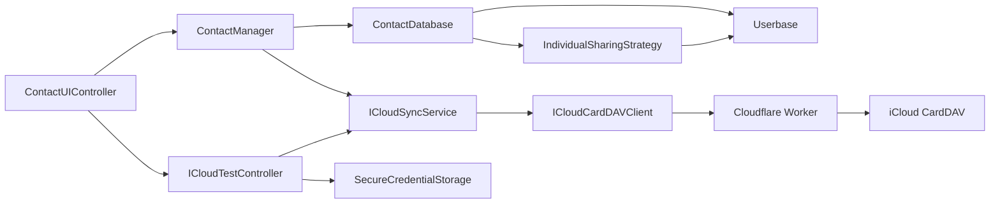

# Contact Management System: Feature, Cleanup, and Review Plan

**Original review:** 2026-09-11 (static review)  
**Revised:** 2026-10-14 — reflects the iCloud consolidation (2026-10-07/08, see [ICLOUD_SYNC_REVIEW.md](ICLOUD_SYNC_REVIEW.md)) and the generic-CardDAV removal + sharing fixes landed on this date.  
**Guard rail:** `npm test` — 14 suites / 97 tests (iCloud sync, Worker proxy, user-to-user sharing, dedup).

## 1. Purpose

A code-grounded picture of what the application is today, what was cleaned up, and — in priority order — what is still worth simplifying. Documentation claims are not treated as implemented unless a production code path exists.

## 2. Status Definitions

| Status | Meaning |
|---|---|
| Implemented | Production code and UI wiring exist. |
| Partial | Core code exists, but integration, correctness, or coverage is incomplete. |
| Legacy/stale | Superseded code remains and may conflict with current architecture. |
| Removed | Deleted from the codebase (date noted). |

## 3. Executive Summary

The application is a Userbase-backed, end-to-end-encrypted contact manager with one external sync target: **iCloud CardDAV** through a Cloudflare Worker proxy.

Since the original review:

- **One sync path.** The generic Baikal/CardDAV path was broken in production (the Worker only allows iCloud hosts and the lite bridge it imported was never shipped) and had no tests. It has been removed — about 9,500 lines across `BaikalConnector`, `BaikalUIController`, `BaikalConfigManager`, `CardDAVBridgeAdapter`, `BaikalURLHelper`, `SyncValidator`, `carddav-presets`, `contact-carddav-bridge-lite/`, and ~900 lines of Baikal branches inside `ContactManager`. `ICloudSyncService` + `ICloudCardDAVClient` is the only, tested sync implementation (its own consolidation history is in `ICLOUD_SYNC_REVIEW.md` §6).
- **Sharing P0s fixed.** Revocation now revokes the recipient's Userbase permission (SH-01). Recipient copies are built from an explicit projection that strips the owner's recipient list, permission map, usage, CardDAV state, and the `CATEGORIES:SHARED:` backup line (SH-02). Both are covered by `tests/sharing/`.
- **Dead modules removed.** `HistoryManager`, `ImportExportIntegration`, `carddav-presets` had zero importers; `TestHelpers` was test-only but shipped in `src/` and now lives in `tests/`.

`src/` went from ~40,600 to ~32,400 lines. The three largest files (`ContactUIController` 6.9k, `ContactDatabase` 4.0k, `ContactManager` 3.9k) remain the main structural debt, but are now free of sync-path branching.

## 4. System Overview



| Component | Responsibility |
|---|---|
| [`ContactManager`](src/core/ContactManager.js) | Contact CRUD, search, lifecycle, sharing orchestration, import, group management, iCloud push hooks. |
| [`ContactDatabase`](src/core/ContactDatabase.js) | Userbase auth, databases, persistence, real-time handlers, shared-database discovery, SDK wrappers. |
| [`IndividualSharingStrategy`](src/core/IndividualSharingStrategy.js) | Per-recipient database creation, recipient projection, update fan-out, revocation. |
| [`ContactUIController`](src/ui/ContactUIController.js) | Main UI coordinator: forms, import/export, sharing, groups, archive, profile links. |
| [`ICloudSyncService`](src/integrations/ICloudSyncService.js) | Two-way sync for owned/imported cards, force-push for shared cards, deletions, timers. |
| [`ICloudCardDAVClient`](src/integrations/ICloudCardDAVClient.js) | CardDAV transport (PROPFIND/REPORT/PUT/DELETE) via the Worker. |
| [`cloudflare-worker/carddav-proxy.js`](cloudflare-worker/carddav-proxy.js) | CORS proxy, iCloud-only host allowlist, origin + token check, conditional-header forwarding, per-IP rate limit. |

## 5. Feature Inventory

### 5.1 Core (unchanged, Implemented)

Sign-up/sign-in/session restore/remember-me/login throttling; contact CRUD with phones, emails, URLs, postal addresses, org/title, birthday, notes; soft delete; archive/restore (owner state on the card, recipient state in `shared-contact-metadata`); usage tracking; bulk delete with sync pause; text search, sorting, filters, statistics; user groups; dark mode; mobile navigation; profile URL sharing; vCard 3.0 import/export (4.0 import accepted), duplicate detection, QR code; PWA install.

### 5.2 Sharing

| Behavior | Status | Notes |
|---|---|---|
| Share with one / many / group | Implemented | Per-recipient `shared-contact-{id}-to-{user}` databases; groups expand at share time. |
| Recipient read-only, no reshare | Implemented | Hardcoded `readOnly: true`, `resharingAllowed: false`. |
| Real-time owner updates | Implemented | `ContactDatabase.updateContact` → `updateContactAcrossSharedDatabases`, now via the recipient projection. |
| Recipient projection | **Implemented 2026-10-14** | `buildRecipientContact()` — see SH-02. |
| Granular revocation | **Implemented 2026-10-14** | Deletes item + `modifyDatabasePermissions({revoke:true})`, idempotent — see SH-01. |
| Optional write access | Not implemented | Parameters exist, strategy ignores them (SH-03). |
| Group provenance | Partial | Add/remove member infers past shares (SH-04). |
| Legacy `distribution-sharing` database | Legacy/stale | Restoration code still runs at startup (31 refs in core) although groups are one-time expansion. |

### 5.3 External sync

| Path | Status |
|---|---|
| iCloud (`ICloudSyncService`) | Implemented, 10 suites of unit coverage. Credentials persisted via `SecureCredentialStorage`; auto-resume on load. |
| Generic CardDAV / Baikal | **Removed 2026-10-14.** Existing databases may still carry `metadata.carddav` without `source: 'iCloud'`; `isICloudSynced()` deliberately ignores it (IS-11). |

## 6. Findings — current status

### Sharing

| ID | Finding | Status |
|---|---|---|
| SH-01 | Revocation did not revoke database permission | **Fixed.** `revokeIndividualAccess()` deletes the item, calls `safeModifyDatabasePermissions({revoke:true})`, treats `UserNotFound`/`DatabaseNotFound`/`DatabaseNotShared` as already-revoked, and reports partial failure. Also fixed: `sanitizeContactId()` stripped the `contact_` prefix in share but not in revoke, so revocation targeted the wrong database name. |
| SH-02 | Recipient copies exposed other recipients | **Fixed.** `buildRecipientContact()` drops `sharing`, `usage`, `carddav`/`cardDAV`, `ui`, `distributionLists`, `sync`, and `CATEGORIES:SHARED:` from the vCard. Used by share and update fan-out. |
| SH-03 | `readOnly`/`resharingAllowed` parameters are misleading | Open — remove the parameters and any UI (recommended). |
| SH-04 | Group membership changes infer provenance | Open — decide one-time expansion vs. provenance records (see §8). |
| SH-05 | Recipient delete vs archive semantics | Open — product rule needed. |
| SH-06 | Username validation creates a permanent database per check | Open — `addUsernameToDistributionList()` opens+shares a throwaway database with no cleanup. |

### Generic CardDAV (CD-01 … CD-07)

All **closed by removal**. The only residue is CD-04 (`cardDAV` vs `carddav` key): `ContactManager` no longer writes the uppercase key; `ICloudSyncService` writes `metadata.carddav`. A one-time reader for the uppercase key is not needed because `isICloudSynced()` already requires `source: 'iCloud'`.

### iCloud (IS-01 … IS-17)

Tracked in `ICLOUD_SYNC_REVIEW.md` §6. Open there: full per-target `carddav` namespacing (moot now that only one target exists — can be dropped), IS-09 (`testConnect()` builds its own client), `ICloudCardDAVClient` XML/discovery unit tests, and the §7 simplification proposal (S-1 … S-5).

### Credentials / security (SEC-01 … SEC-04)

Unchanged since the original review; `SecureCredentialStorage` is now used by the iCloud modal only. SEC-01 (session-storage option advertised but no write branch), SEC-02 (private-mode salt via `localStorage`), SEC-03 (plaintext JSON fallback) remain open. SEC-04 (public Worker token) is mitigated by the Worker's per-IP rate limit and origin allowlist.

## 7. Data and Contract Invariants (target)

```text
vCard UID       Stable cross-system identity (== contactId for app-created cards)
contactId       Local domain identity
itemId          Userbase item key; never inferred after persistence
metadata.carddav{ etag, href, source:'iCloud', lastSyncedAt }  — single target, no per-profile map needed
```

Contact type should be one derived value (`owned | imported | shared`) instead of scattered `isOwned`/`isImported`/`startsWith('shared_')` checks (`ContactRenderer.getContactType` already exists — use it everywhere).

Sharing metadata lives in exactly three places: owner card (`metadata.sharing`), recipient copy (projection: `sharedBy`, `sharedWith`, `originalContactId`), recipient private state (`shared-contact-metadata`).

## 8. Simplification Backlog

Ordered by value ÷ risk. Each item is a standalone commit with `npm test` green.

### Phase A — remove accidental complexity (low risk)

- [ ] **Drop the legacy `distribution-sharing` database path.** Groups are one-time expansion; the restoration code (`handleDistributionSharingChanged`, `attemptDistributionSharingRestoration`, `saveDistributionListSharing`, `pendingDistributionSharing` state) and `USERBASE_CONFIG.databases.distributionSharing` can go. Resolves SH-04 by decision. Keep `revokeDistributionListAccess` as an explicit bulk revoke only.
- [ ] **Remove the fake write-permission surface (SH-03):** delete `readOnly`/`resharingAllowed` parameters through `ContactManager`/`ContactDatabase`/UI; document sharing as read-only.
- [ ] **Replace the throwaway validation database (SH-06)** with one reusable `username-validation` database (share/revoke against it), or drop pre-validation and surface the `UserNotFound` error from the real share.
- [ ] **Collapse the two vCard façades.** `VCardStandard` (→ `VCardFormatManager` → 3/4 processors) and `VCardStandardEnhanced` (used only by `VCardImporter`/`VCardExporter`) overlap; keep one entry point.
- [ ] **Align validation with 3.0:** `ContactManager` still calls `validateContactData(…, '4.0', …)` in two places.
- [ ] **Delete remaining dead helpers:** `findAndDeleteCorruptedContacts()` is console-only; `UserbaseConnectionFix.js` (global fetch monkey-patch) and `AuthPerformanceTracker` should be re-justified or removed.
- [ ] **Decide the `CATEGORIES:SHARED:` backup.** It existed for CardDAV disaster recovery of the owner's recipient list. With Baikal gone, it leaks into vCard/QR exports and iCloud pushes (each strips it separately). Recommended: remove generation + the three strip sites.

### Phase B — iCloud sync rules (ICLOUD_SYNC_REVIEW §7, in that order)

- [ ] S-1 dirty flag instead of timestamp comparison (fixes the pull-clobbers-unpushed-edit bug).
- [ ] S-3 archived = frozen in both directions.
- [ ] S-2 drop `sharedContactSyncCache`.
- [ ] S-5 collapse the deletion state machine to tombstones.
- [ ] S-4 one periodic cycle instead of three timers.
- [ ] IS-09: route `testConnect()` through `ICloudSyncService.initialize()`.
- [ ] Remove the IC-06 synthetic `shared-contact@userbase.app` email; report unsupported cards instead.

### Phase C — credentials

- [ ] Implement or remove the advertised session-storage option (SEC-01).
- [ ] Private-mode salt without `localStorage` (SEC-02).
- [ ] Remove the plaintext JSON credential fallback (SEC-03).

### Phase D — structure (only after A–C; contracts are then small enough to test)

- [ ] Split `ContactUIController` by workflow (auth, list/detail, form, import/export, sharing, groups).
- [ ] Extract from `ContactManager`: import/dedup, sharing orchestration, groups.
- [ ] Extract from `ContactDatabase`: auth, SDK wrappers/validation, shared-database discovery.
- [ ] Use `ContactRenderer.getContactType()` everywhere a type check is made.

### Phase E — verification

- [ ] `ICloudCardDAVClient` unit tests from the existing XML fixtures.
- [ ] Sharing tests for group share, bulk revoke, and recipient-side normalization (`handleContactsChanged` shared branch).
- [ ] One browser smoke test (app boots, modals open, no console errors) — currently done by hand.

## 9. Definition of Done

- One sync path (iCloud) with explicit, tested connector behavior. ✅
- Revocation removes data **and** permission for exactly one recipient. ✅
- Recipient copies contain no owner-only sharing metadata. ✅
- Groups are one-time expansion with no retroactive inference (Phase A).
- Sharing is documented and implemented as read-only, with no dead permission parameters (Phase A).
- Archive, delete, and sync rules are each stated in one sentence and encoded in one place (Phase B).
- Credential UI choices match actual storage behavior (Phase C).
- No file in `src/` is unreferenced from `index.html`/`app.js`; `production_zip.sh`'s critical-file list matches the tree. ✅ (re-check per release)

## 10. Review Notes

- This is a static-review-plus-unit-test baseline, not proof of live iCloud behavior. Live iCloud sync should be smoke-tested after the Phase B refactor.
- `tests/manual/`, `scripts/`, `docs/archive/`, `tools/` are local-only (whitelist `.gitignore`) and may reference removed code; they are not shipped.
- The `.github/copilot-instructions.md` architecture notes still describe the Baikal bridge, separate addressbooks, and ACL protection. They should be reduced to the iCloud-only model so future generated code does not re-introduce the removed path.
